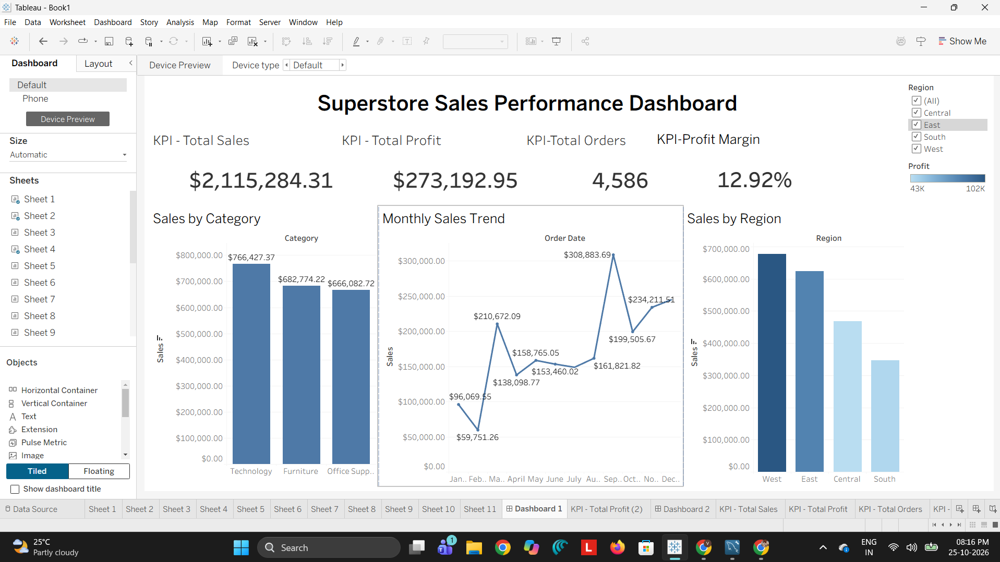
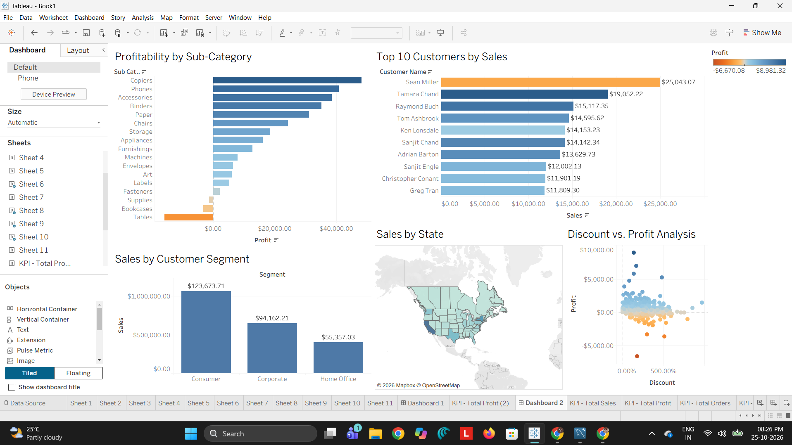

# TableauPulse — Retail Sales Intelligence Dashboard

TableauPulse is an interactive retail sales analytics dashboard built to explore sales performance, profitability, regional trends, product performance, and potential business risks. It combines calculated analytics with AI-generated business interpretations to help users investigate patterns in retail data.

## Project Goals

- Monitor sales, profit, and profit margin.
- Compare performance across product categories and regions.
- Identify loss-making subcategories and products for further investigation.
- Explore how observed profitability differs across discount bands.
- Present calculated findings alongside AI-generated interpretations and suggested actions.
- Review basic data-quality checks.

## Technology Stack

- **Language:** Python
- **Data analysis:** Pandas
- **Database:** MySQL
- **Dashboard:** Streamlit
- **Charts:** Plotly
- **Local LLM integration:** Ollama with `llama3.2:1b`
- **Version control:** Git and GitHub

## Dashboard Sections

1. **Sales Overview** — summarizes overall sales and profit performance.
2. **Category Analysis** — compares profitability across categories and subcategories.
3. **Regional Analysis** — explores differences in sales and profit across regions.
4. **AI Insights** — presents AI-generated interpretations of analytical findings.
5. **Business Recommendations** — displays calculated findings, supporting evidence, suggested actions, and limitations.
6. **Data Quality** — presents checks related to the dataset.

## Example Findings

The current analysis of 10,194 valid records reports the following:

- **Furniture:** 2.61% aggregate profit margin.
- **Technology:** 17.45% aggregate profit margin.
- **Tables:** approximately $17,753.21 aggregate loss.
- **Tables in the East region:** approximately $11,086.15 aggregate loss.
- **Discounts above 50%:** approximately -118.71% aggregate profit margin.

These are descriptive results from the dataset, not proof of why a result occurred. Confirm the figures against the current dashboard if the dataset or analysis changes.

## How It Works

At a high level, the project:

1. Uses prepared retail sales data for analysis.
2. Calculates sales, profit, margin, and other grouped findings with Python/Pandas and SQL where applicable.
3. Presents metrics and visualizations in a Streamlit dashboard using Plotly.
4. Sends selected analytical findings to a locally running Ollama model for natural-language interpretation.
5. Displays the interpretations alongside the calculated evidence so users can review them.

**Data-flow note:** The project contains a cleaned CSV and a MySQL table. Update this section to state which source `app.py` actually reads at runtime; do not claim that the dashboard reads from MySQL unless the code confirms it.

## Running the Project Locally

### Prerequisites

- Python installed
- MySQL Server, if required by the current application configuration
- Ollama installed for AI-generated interpretations
- The project data and configuration available locally

### Setup

1. Clone or download the repository.
2. Open a terminal in the project directory.
3. Create and activate a Python virtual environment.
4. Install the dependencies listed in `requirements.txt`, if that file is present and up to date.
5. Configure the database connection and ensure the required data source is available.
6. Install the local Ollama model:

   ```bash
   ollama pull llama3.2:1b
   ```

7. Start Ollama.
8. Run the Streamlit application:

   ```bash
   streamlit run app.py
   ```

Follow the project's actual configuration requirements. Do not commit passwords, database credentials, API keys, or other secrets to GitHub.

## Dashboard Previews

### Dashboard 1


### Dashboard 2

## Limitations

- Analysis is limited to the fields and costs available in the dataset.
- Differences in profitability across discount bands do not establish that discounts caused the observed losses.
- Product-level results based on few records may not represent long-term performance.
- Business recommendations should be considered alongside additional business context before operational decisions are made.

## Future Enhancements

The following are potential improvements, not claims about features already implemented:

- Add date-range filters and more detailed drill-downs.
- Improve data-quality reporting.
- Add downloadable analytical reports.
- Evaluate AI-generated interpretations against the calculated evidence.

## Author

**Vaishnavi Chedudhupu**

